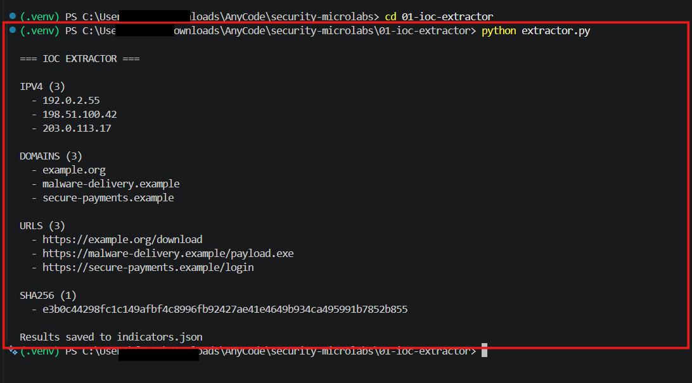

# 01 — IOC Extractor

A lightweight Python tool that extracts common indicators of compromise (IOCs) from an unstructured security incident report and writes the results to JSON.

## Problem

Incident reports and investigation notes often contain indicators in ordinary text. Analysts need a repeatable way to collect common indicator types before validating or enriching them.

This lab automates the initial extraction step. It does **not** determine whether an indicator is malicious.

## Features

- Extracts IPv4 address candidates and validates them with Python's `ipaddress` module.
- Extracts HTTP and HTTPS URLs.
- Extracts domain-like strings from the report and hostnames parsed from extracted URLs.
- Extracts 64-character hexadecimal strings as SHA-256-shaped values.
- Removes duplicates and sorts each result category.
- Writes the findings to `indicators.json`.
- Includes pytest tests for extraction, invalid IPv4 values, duplicate removal and empty input.

## Technologies

- Python 3
- `re` — regular-expression matching
- `ipaddress` — IPv4 validation
- `urllib.parse` — URL parsing
- `pathlib` — file paths and file I/O
- `json` — structured output
- pytest — automated tests

The extraction workflow uses Python's standard library. pytest is needed to run the tests.

## Project structure

```text
01-ioc-extractor/
├── samples/
│   └── report.txt
├── tests/
│   └── test_extractor.py
├── extractor.py
├── indicators.json       # generated output
└── README.md
```

## Run

From this directory:

```powershell
python extractor.py
```

The script reads `samples/report.txt`, prints the extracted indicators by category and writes `indicators.json` beside `extractor.py`.

The input and output paths are currently defined in the script; command-line path arguments are not implemented.

## Example output

The supplied sample report contains documentation-only IP addresses, example domains, URLs and a SHA-256-shaped string. Its generated output includes categories named:

- `ipv4`
- `domains`
- `urls`
- `sha256`

The sample also contains an invalid IPv4 candidate (`999.999.999.999`), which is rejected by IPv4 validation.

## Test

Install pytest if it is not already available:

```powershell
python -m pip install pytest
```

Run the tests:

```powershell
python -m pytest -v
```

The test suite checks valid and invalid IPv4 extraction, duplicate removal, URL punctuation handling, domain extraction, SHA-256-shaped extraction and empty-report behavior.

## Implementation notes and limitations

- IPv4 candidates are validated as IPv4 addresses; IPv6 extraction is not implemented.
- URL extraction uses a regular expression followed by `urlsplit` hostname parsing. It is a practical lab parser, not a complete URL validator.
- Domain extraction uses a basic regular expression. It can identify filename-like strings such as `payload.exe` as domain-like values; this is a known false-positive limitation.
- A 64-character hexadecimal match is identified by shape only. The tool does not hash a file or verify that the value belongs to a particular file.
- Defanged indicators are not normalized.
- The tool processes one predefined text file and does not assess indicator reputation.

## Future improvements

- Add command-line arguments for input and output paths.
- Normalize defanged indicators.
- Improve domain validation to reduce filename-related false positives.
- Add support for additional indicator types and edge cases.
- Connect extracted indicators to a reputation or threat-intelligence workflow.

## Execution Screenshot


