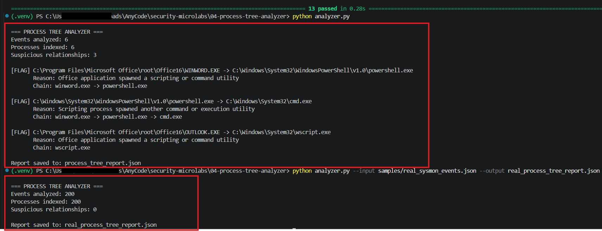

# 04 — Process Tree Analyzer

A Python SOC investigation tool that reconstructs parent-child process relationships from JSON-exported Sysmon Event ID 1 (Process Creation) records and flags selected suspicious process relationships.

## Problem

A process name viewed in isolation rarely tells the full story. Parent-child relationships and execution chains help analysts understand how an application or script was launched and what it started next.

This lab uses Sysmon process GUIDs to rebuild those relationships and highlight a small set of behaviors worth investigating.

## Features

- Loads a JSON array of Sysmon process-creation events.
- Keeps Event ID 1 records and checks required process fields.
- Indexes processes by `ProcessGuid` and rejects duplicate GUIDs.
- Resolves parent events through `ParentProcessGuid`.
- Retains `ParentImage` when the parent's creation event is not in the input.
- Reconstructs root-to-process chains and detects cycles.
- Flags selected Office-to-script and script-to-command relationships.
- Exports a JSON report with summary counts, all normalized processes, flagged processes, reasons and process chains.
- Includes pytest coverage using synthetic event fixtures.

## Technologies

- Python 3
- Sysmon Event ID 1 data
- JSON
- `argparse`, `pathlib` and `json` (Python standard library)
- pytest

The analyzer itself uses only the Python standard library. pytest is required for the automated tests.

## Project structure

```text
04-process-tree-analyzer/
├── samples/
│   ├── sysmon_events.json
│   └── real_sysmon_events.json   # optional real endpoint sample
├── tests/
│   └── test_analyzer.py
├── analyzer.py
├── requirements.txt
└── README.md
```

The repository may also contain generated reports such as `process_tree_report.json` and `real_process_tree_report.json`. These are outputs, not required source files.

## Installation

From this directory:

```powershell
python -m pip install -r requirements.txt
```

The requirements file installs pytest.

## Run

Use the supplied synthetic sample:

```powershell
python analyzer.py
```

The defaults are:

- Input: `samples/sysmon_events.json`
- Output: `process_tree_report.json`

Specify another input or output path:

```powershell
python analyzer.py --input samples/real_sysmon_events.json --output real_process_tree_report.json
```

The script prints the number of events analyzed, processes indexed and suspicious relationships, followed by each flagged parent-child relationship and its reconstructed chain.

## Test

```powershell
python -m pytest -v
```

The test suite covers process-name extraction, Event ID filtering, invalid input, missing and duplicate process GUIDs, parent resolution, Office/script heuristics, full chain construction, report summary and missing-parent handling.

## Detection heuristics

The analyzer currently flags two relationship categories:

1. An Office application spawning a selected scripting or command utility, including PowerShell, command prompt, Windows Script Host, MSHTA or Rundll32.
2. A selected scripting process spawning another command or execution utility.

These are deliberately small behavioral heuristics. They are not a complete detection framework and may produce false positives. A flagged relationship should be investigated using command-line content, user context, timestamps, file details, network activity and surrounding endpoint telemetry.

## Data model

The analyzer uses these Sysmon fields:

| Field | Purpose |
|---|---|
| `EventID` | Selects process-creation events (1) |
| `ProcessGuid` | Identifies the created process |
| `ParentProcessGuid` | Links the process to its parent event |
| `Image` | Executable path of the created process |
| `ParentImage` | Parent executable path, including when its event is absent |
| `CommandLine` | Command line of the created process |
| `ParentCommandLine` | Parent command-line context when supplied |
| `ProcessId` / `ParentProcessId` | Process identifiers included in normalized output |
| `UtcTime` | Event timestamp included in normalized output |
| `User` | User context included in normalized output |

## Synthetic and real telemetry

`sysmon_events.json` is the synthetic learning fixture used by the automated tests. `real_sysmon_events.json`, when included, is a sample export from a Windows lab endpoint and can be selected with `--input`.

Review real telemetry before publishing or sharing it. Remove or anonymize usernames, hostnames, internal paths, network details and other environment-specific information where appropriate. Do not assume endpoint logs are safe to publish simply because they are JSON.

## Limitations

- Accepts a JSON array, not raw EVTX files or XML exports.
- Expects Sysmon Event ID 1 field names.
- Does not correlate across hosts or boot sessions.
- Uses a small set of hard-coded behavioral heuristics.
- Does not establish whether a process is malicious or whether an incident occurred.
- Parent resolution depends on the parent event being present; otherwise the supplied `ParentImage` is retained as context.

## Future improvements

- Add EVTX and XML ingestion.
- Add host identifiers and time-aware correlation.
- Export a visual process tree.
- Support configurable detection rules and Sigma integration.
- Add more process-behavior tests and configurable allowlists.


## Execution Screenshot



## Validation

- 13 automated tests passed.
- 6 synthetic events analyzed.
- 3 suspicious process relationships detected.
- 200 real Sysmon events successfully processed.
- No suspicious relationships matched in the real sample.
