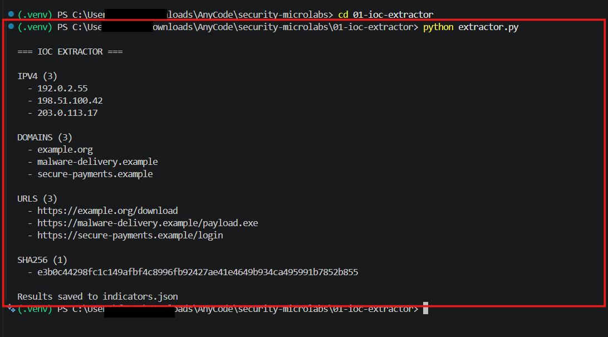
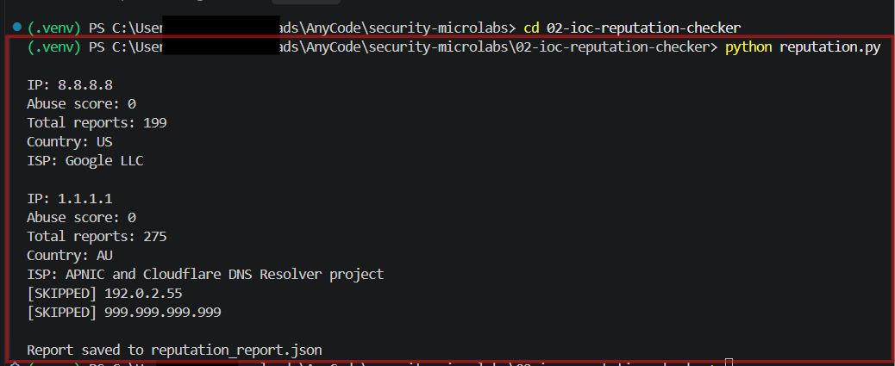
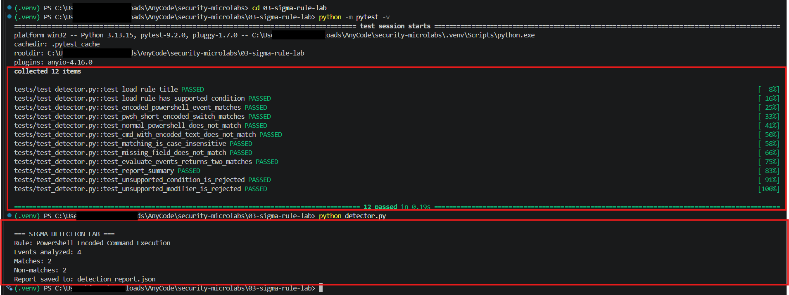
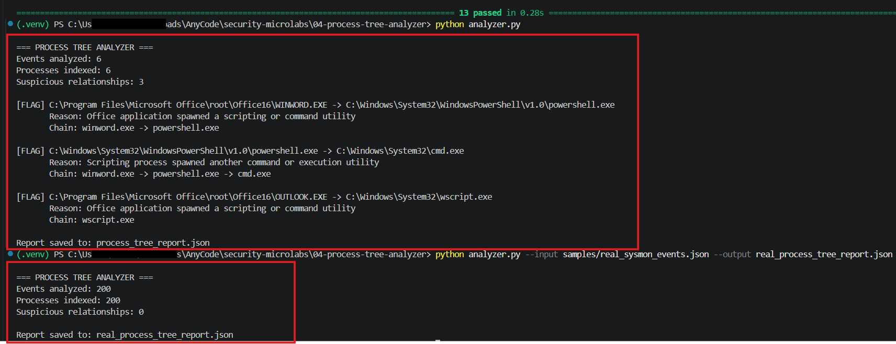
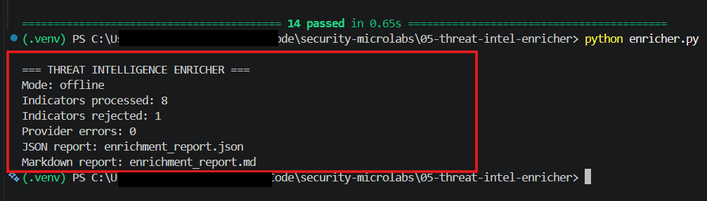
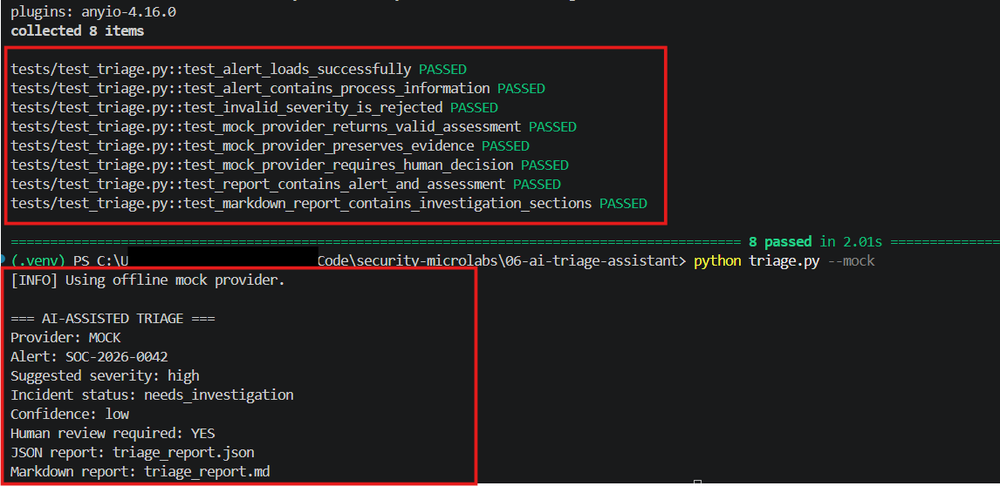

# Python Security Micro-Labs

**Independent tools. Practical SOC automation. Detection engineering.**

A collection of six independent Python projects exploring practical cybersecurity automation, threat intelligence, detection engineering, endpoint investigation, and AI-assisted security analysis.

This repository documents my hands-on engineering journey building small, focused security tools that solve meaningful problems encountered in security operations.

Rather than building one large application, each micro-lab focuses on a specific security task, its underlying engineering concepts, and a working implementation.

---

## Project Gallery

### 01. IOC Extractor



Extract IPv4 addresses, domains, URLs, and SHA-256 hashes from security reports and text-based incident evidence.

**Key concepts:** Python, regular expressions, IP validation, file handling, JSON, automated testing.

[Explore Project](01-ioc-extractor/)

### 02. IOC Reputation Checker



Validate public IP addresses and query reputation information to identify potentially suspicious network indicators.

**Key concepts:** Python, IP address validation, REST APIs, requests, environment variables, error handling.

[Explore Project](02-ioc-reputation-checker/)

### 03. Sigma Detection Rule Lab



Build and evaluate a Sigma-inspired detection rule for suspicious PowerShell execution against sample security events.

**Key concepts:** Sigma, YAML, Python, detection logic, event evaluation, testing.

**Scope:** Implements a documented subset of Sigma rule conditions, not a complete Sigma backend.

[Explore Project](03-sigma-rule-lab/)

### 04. Process Tree Analyzer



Analyze Sysmon Event ID 1 process creation records, reconstruct parent-child relationships, and flag suspicious process chains.

**Key concepts:** Sysmon, Windows endpoint telemetry, process relationships, Python, JSON, behavioral detection.

[Explore Project](04-process-tree-analyzer/)

### 05. Threat Intelligence Enricher



Enrich indicators with external threat intelligence context and generate structured investigation reports.

**Key concepts:** Threat intelligence APIs, VirusTotal, AbuseIPDB, data normalization, Python, JSON, Markdown.

**Scope:** Supports offline operation and provider integrations. Live lookups depend on valid API credentials and provider availability.

[Explore Project](05-threat-intel-enricher/)

### 06. AI-Assisted Triage Assistant



Analyze structured security alerts and generate investigation guidance, severity suggestions, and triage reports.

**Key concepts:** Python, OpenAI API integration, mock providers, structured outputs, validation, human-in-the-loop security workflows.

**Scope:** The demonstrated execution uses an offline mock provider. Live OpenAI analysis requires API access and available API credits.

[Explore Project](06-ai-triage-assistant/)

---

## Technology Stack

| Area | Technologies |
|---|---|
| Programming | Python |
| Data handling | JSON, regular expressions, YAML |
| APIs | Requests, REST APIs |
| Security telemetry | Sysmon, Windows process creation events |
| Detection engineering | Sigma-inspired rules, behavioral analysis |
| Threat intelligence | VirusTotal, AbuseIPDB |
| AI integration | OpenAI API, offline mock provider |
| Testing | pytest |
| Development | Visual Studio Code, Git, GitHub |

## Testing and Validation

Each micro-lab includes automated tests covering important functionality, expected behavior, and selected edge cases.

Confirmed test results:

| Project | Tests passed |
|---|---:|
| 01 — IOC Extractor | 8 |
| 02 — IOC Reputation Checker | 6 |
| 03 — Sigma Detection Rule Lab | 12 |
| 04 — Process Tree Analyzer | 13 |
| 05 — Threat Intelligence Enricher | 14 |
| 06 — AI-Assisted Triage Assistant | 8 |
| **Total** | **61** |

The IOC Reputation Checker also includes automated tests. See its project README for its validation details.

Run tests from an individual project directory:

```powershell
python -m pytest -v
```

## Repository Structure

```text
security-microlabs/
│
├── 01-ioc-extractor/
├── 02-ioc-reputation-checker/
├── 03-sigma-rule-lab/
├── 04-process-tree-analyzer/
├── 05-threat-intel-enricher/
├── 06-ai-triage-assistant/
│
├── docs/
│   └── screenshots/
│
├── .gitignore
├── LICENSE
└── README.md
```

Each project contains its own implementation, sample data, tests, dependencies, and documentation where applicable.

## Security Considerations

- API credentials are stored in local environment files and should never be committed.
- `.env.example` files provide configuration templates without exposing secrets.
- Reserved example indicators are used where appropriate for safe demonstrations.
- Generated reports and real endpoint telemetry should be reviewed before publication.
- AI-generated assessments are advisory and require human verification.
- Reputation results and threat intelligence findings should not be treated as definitive proof of malicious activity.

## Engineering Approach

My focus throughout these projects has been to:

1. Identify a practical security operations problem.
2. Break it into smaller engineering components.
3. Implement reusable Python functionality.
4. Validate inputs and handle errors.
5. Test expected behavior and edge cases.
6. Generate useful, structured outputs.
7. Document implementation decisions and limitations.

## About This Repository

This is an evolving collection of practical cybersecurity engineering projects documenting my development in Python automation, blue-team operations, threat intelligence, and detection engineering.

**Monitor. Detect. Investigate. Respond. Automate.**

---

## License

This repository is licensed under the MIT License. See [LICENSE](LICENSE) for details.


## Author

**Favogab — Favour Gabriel**

Cybersecurity | Blue Team | SOC Operations | Security Automation | Python

[GitHub](https://github.com/favogab) · [Security Micro-Labs Repository](https://github.com/favogab/security-tools-microlabs)